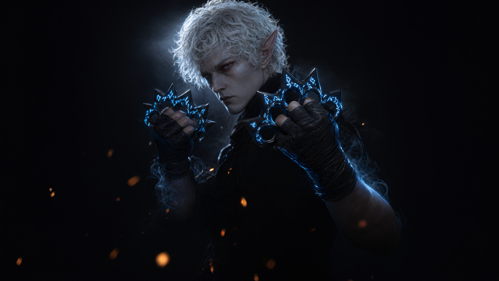

# Monk Weapon: Knuckle Dusters — source repository

Source, tools and research notes for the Baldur's Gate 3 mod
**Monk Weapon - Knuckle Dusters (Unarmed Fist Weapons)**.

Three knuckle dusters that resolve as **monk unarmed strikes while still being real weapon
attacks** — so weapon riders (Holy Weapon, Elemental Weapon, third-party boosters), Tavern
Brawler and Monk Weapon dice all work together.



---

## Open invitation to improve it

**Anyone who is interested and able is welcome to modify these files directly to improve
the model — or anything else.**

The knuckle duster models are the weakest part of this release. They are functional and
they read correctly in-game, but they were reconstructed from multi-view references and
retopologised by hand rather than sculpted by a professional. If you can make a better
mesh, better normals, better UVs, a better grip alignment or better textures:

* fork this repository, change whatever you like, and open a pull request, **or**
* ship your own version of the pak — no permission needed, see the licences below.

You do not need to ask first, and you do not need to credit anyone beyond keeping the
notice files intact.

---

## What is in here

```
mod/stats/       stat definitions (weapons, attacks, statuses, passives, overrides)
mod/meta/        meta.lsx (mod identity)
mod/scriptextender/  optional Lua, manual `!kd` console command only
mod/tools/       every script used to produce this mod
mod/assets/      3 OBJ models, PNG + BC7 DDS textures, AO maps, icons
mod/docs/        three research notes written while reverse-engineering the systems
docs/            MOD_STRUCTURE.md (human guide) + AGENT_GUIDE.md (automation brief)
```

Start with **[docs/MOD_STRUCTURE.md](docs/MOD_STRUCTURE.md)**.
If you are an agent working on this repo, read **[docs/AGENT_GUIDE.md](docs/AGENT_GUIDE.md)**
first — it lists the invariants that break the mod silently and a pre-pack checklist.

---

## Design summary

| Concern | Decision | Why |
|---|---|---|
| Attack cost | `UseCosts "ActionPoint:1"` | Bonus Action would disable Extra Attack |
| Damage chain | `UnarmedDamage` + `MainMeleeWeapon` + `ExecuteWeaponFunctors(MainHand)` | keeps monk scaling *and* lets any weapon rider fire |
| Off-hand | `NoDualWield` property (not `Twohanded`) | blocks the off-hand slot without forcing the two-handed grip pose |
| Flurry | per-variant overrides for Push/Knock/NoReactions | Open Hand re-overrides `SpellSuccess`; base-spell edits are ignored |
| Vendors | `CanMerge 1` appends to Dammon's three per-act tables | same-name table replacement would wipe his stock |
| Pricing | vanilla Rare/VeryRare/Legendary `ValueUUID`s | invented UUIDs price at 15 gp |
| Languages | all 13 BG3 languages shipped as .loca | a missing handle renders `Not Found` |

Full reasoning, file-by-file: **[docs/MOD_STRUCTURE.md](docs/MOD_STRUCTURE.md)**.

---

## Build

```powershell
python mod/tools/gen_knuckles.py                 # regenerate stat txt (optional)
python mod/tools/polish_textures.py              # optional texture cleanup
powershell mod/tools/integrate_models_tex.ps1    # texconv BC7 + pak
```

Requires: Python 3.11+, [LSLib](https://github.com/Norbyte/lslib) (`Divine.exe`), the BG3
Toolkit preprocessor, Blender 4.5 (only if you rebuild the models).

`wire_visuals.py` regenerates stat files only when `KD_REGEN_STATS=1` — it used to revert
hand-edited stats silently.

---

## Licences

This repository is intentionally split, because code and 3D art have different norms:

| Content | Licence | File |
|---|---|---|
| Scripts, stat files, documentation | **MIT** | [`LICENSE`](LICENSE) |
| 3D models, textures, icons, banner | **CC BY 4.0** | [`LICENSE-ASSETS`](LICENSE-ASSETS) |

In short: use it, change it, ship it, sell it — keep the notices and say where it came
from. `CC BY 4.0` for the art means attribution is required; nothing else is restricted.

Baldur's Gate 3 and its assets belong to Larian Studios. This repository contains only
original work (stat definitions, scripts, meshes and textures authored for this mod).

---

## Compatibility

BG3 Patch 8 (`4.1.1.7209685`). Overrides the Flurry / UnarmedStrike / OpenHandTechnique
spell family; load **after** any other mod touching monk spells or unarmed attacks.

Known side effect, by design: `Target_UnarmedAttack` is a global override, so punching
while holding a weapon adds that weapon's damage. Bare hands are unaffected.
